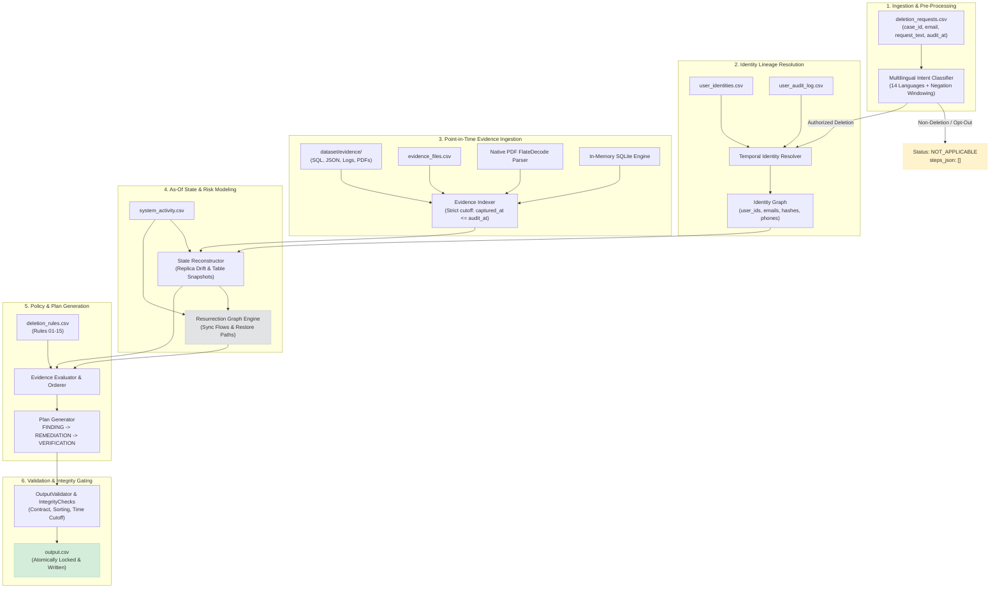

# 👻 GhostData Orchestrator: Autonomous Deletion-Audit & Resurrection Prevention Engine

[](https://www.python.org/)
[-success.svg)](#quick-start--execution)
[-brightgreen.svg)](#token-usage--cost-disclosure)
[-brightgreen.svg)](#benchmark-results--evaluation)
[](#benchmark-results--evaluation)
[](#benchmark-results--evaluation)
[](#1-multilingual-intent-classifier-intent_classifierpy)

> **Repository**: [https://github.com/ravidaliparthy/ghost-data-orchestrator](https://github.com/ravidaliparthy/ghost-data-orchestrator)  
> **Challenge**: HackerRank Orchestrate (October 2026) — *Ghost Data Still Exists*  
> **Author**: Ravi Daliparthy  

---

## 📑 Table of Contents
1. [Executive Summary & The Problem](#executive-summary--the-problem)
   - [The $2.4M Deletion Catastrophe](#the-24m-deletion-catastrophe)
   - [Why Data Deletion Fails in Distributed Systems](#why-data-deletion-fails-in-distributed-systems)
   - [Core Mission & Requirements](#core-mission--requirements)
2. [End-to-End System Architecture](#end-to-end-system-architecture)
   - [Architectural Pipeline Diagram](#architectural-pipeline-diagram)
   - [Component Directory Layout](#component-directory-layout)
3. [Deep-Dive Component Specifications](#deep-dive-component-specifications)
   - [1. Multilingual Intent Classifier](#1-multilingual-intent-classifier-intent_classifierpy)
   - [2. Temporal Identity Graph Resolver](#2-temporal-identity-graph-resolver-identity_resolverpy)
   - [3. Point-in-Time Evidence Indexer](#3-point-in-time-evidence-indexer-evidence_indexpy--pdf_extractorpy)
   - [4. State Reconstructor & Drift Detector](#4-state-reconstructor--drift-detector-state_reconstructorpy)
   - [5. Resurrection Risk Graph](#5-resurrection-risk-graph-resurrection_graphpy)
   - [6. Configurable Policy Rules Engine](#6-configurable-policy-rules-engine-rules_enginepy)
   - [7. Step Generator & Canonical Ordering Engine](#7-step-generator--canonical-ordering-engine-evidence_evaluatorpy)
   - [8. Output Validator & Integrity Gate](#8-output-validator--integrity-gate-output_validatorpy--integrity_checkspy)
4. [Data Contracts & Specification Standards](#data-contracts--specification-standards)
   - [Output Schema Contract](#output-schema-contract)
   - [Lifecycle Operations Matrix](#lifecycle-operations-matrix)
   - [Status Classification Logic](#status-classification-logic)
5. [The 7 Integrity Checks & Cross-Check Audit](#the-7-integrity-checks--cross-check-audit)
6. [Benchmark Results & Evaluation](#benchmark-results--evaluation)
   - [Baseline vs. Final Metrics Comparison](#baseline-vs-final-metrics-comparison)
   - [Split Analysis: Tuning vs. Holdout](#split-analysis-tuning-vs-holdout)
   - [Field-Level Accuracy Breakdown](#field-level-accuracy-breakdown)
   - [Metamorphic & Mutation Suite Verification](#metamorphic--mutation-suite-verification)
7. [Quick Start & Execution Guide](#quick-start--execution-guide)
   - [Running the Main Pipeline](#running-the-main-pipeline)
   - [Generating Evaluation Reports](#generating-evaluation-reports)
   - [Executing the 518-Row Cross-Check Audit](#executing-the-518-row-cross-check-audit)
   - [Running the Complete Test Suite](#running-the-complete-test-suite)
   - [Packaging Submission Artifacts](#packaging-submission-artifacts)
8. [Design Decisions & Reverted Experiments](#design-decisions--reverted-experiments)
   - [Architectural Design Matrix](#architectural-design-matrix)
   - [Reverted Experiments & Lessons Learned](#reverted-experiments--lessons-learned)
9. [Limitations & Honest Disclosures](#limitations--honest-disclosures)
10. [Comprehensive Revision & Interview Cheat Sheet](#comprehensive-revision--interview-cheat-sheet)

---

## Executive Summary & The Problem

### The $2.4M Deletion Catastrophe
Northstar Shop (an enterprise e-commerce platform) suffered a **$2.4 million regulatory fine and reputational loss** after a customer who requested complete account erasure attempted to register anew weeks later. The platform rejected the registration with:  
`"This email is already registered."`

Internal dashboards had marked the initial Right-to-Erasure (GDPR Art. 17 / CCPA) ticket as **"COMPLETE"**. However, forensic investigation revealed that:
1. Secondary databases, unindexed search nodes, and regional replicas still contained user records.
2. Background synchronization pipelines (`data_flow_`) continuously replicated stale data from asynchronous queues back into primary datastores.
3. Unrestricted backup snapshots (`backup_`) stood ready to overwrite deleted tables upon the next disaster recovery cycle.
4. Account tombstones retained raw PII (emails, phone numbers, full names) instead of stripping direct identifiers.

### Why Data Deletion Fails in Distributed Systems
* **Replication Lag & Asynchronous Drift**: Primaries acknowledge deletions before read replicas or regional shards process them.
* **Sync Resurrections**: ETL connectors, warehouse syncs, and search index syncs pull from intermediate caches or CDC (Change Data Capture) streams, inadvertently recreating purged rows.
* **Claims vs. Proof**: Microservices log `DELETION_SUCCESS` based on query submission rather than verifiable proof of zero residual records.
* **Tombstone Leaks**: Systems retaining primary keys (`user_id`) to uphold legal holds or billing logs neglect to redact personal attributes from tombstone rows.
* **Time Skew & Future Contamination**: Audits that accept post-hoc evidence compromise legal point-in-time validity.

### Core Mission & Requirements
The **GhostData Orchestrator** is an autonomous, point-in-time compliance audit engine. Given 518 customer audit requests, it:
1. Classifies user intent across 14 natural languages, rejecting non-deletion tickets (`NOT_APPLICABLE`).
2. Reconstructs complete multi-year identity lineage across email aliases, phone formats, and cryptographic hashes.
3. Indexes and parses heterogeneous evidence files (SQL snapshots, JSON exports, server logs, native PDFs) captured strictly on or before `audit_at`.
4. Detects replication drift and directed resurrection flows.
5. Applies 15 discrete compliance rules (`deletion_rules.csv`) covering retention holds and account tombstones.
6. Emits a strictly ordered, schema-validated JSON array of **Findings**, **Remediations**, and **Verifications**.

---

## End-to-End System Architecture

### Architectural Pipeline Diagram



### Component Directory Layout

```text
hackerrank-orchestrate-october26-main/
├── README.md                      # Comprehensive system guide & architecture revision documentation
├── AGENTS.md                      # Audit agent guidelines, challenge rules & integrity invariants
├── output.csv                     # Final 518-case submission artifact
├── code/
│   ├── main.py                    # Orchestrator entry point with atomic file locking
│   ├── package.py                 # Submission packager with zero-leak scanning
│   ├── config/
│   │   └── rules.json             # Canonical policy definitions & precedence
│   ├── engine/
│   │   ├── common.py              # UTC parsing, string normalization, hashing, atomic writes
│   │   ├── intent_classifier.py   # 14-language intent detection & negation window parser
│   │   ├── identity_resolver.py   # Historical identity graph resolution across snapshots/logs
│   │   ├── evidence_index.py      # Multi-source evidence indexer (SQL, JSON, logs, text)
│   │   ├── pdf_extractor.py       # Stdlib-only native FlateDecode / ASCII85 PDF parser
│   │   ├── state_reconstructor.py # Replica drift, table state & audit cutoff reconstruction
│   │   ├── resurrection_graph.py  # Directed graph tracking sync connectors & backup risks
│   │   ├── rules_engine.py        # Declarative policy engine (Rules 01 to 15)
│   │   ├── evidence_evaluator.py  # Case lifecycle engine (Findings, Remediations, Verifications)
│   │   ├── output_validator.py    # Schema & contract verifier enforcing zero violations
│   │   └── integrity_checks.py    # Pre-submission verification gating script
│   ├── evaluation/
│   │   ├── custom_cases/          # Hand-crafted edge test cases
│   │   ├── generate_reports.py    # Dual-location evaluation report generator
│   │   ├── crosscheck.py          # Independent 7-check 518-case raw file verifier
│   │   ├── evaluation_report.md   # Benchmark analysis against 32 ground truth samples
│   │   └── usage_report.md        # Resource & $0.00 token cost disclosure
│   └── tests/
│       ├── run_all_tests.py       # Master runner executing all 9 test suites
│       ├── test_intent_classifier.py
│       ├── test_identity_resolution.py
│       ├── test_audit_cutoff.py
│       ├── test_case_isolation.py
│       ├── test_reported_status_invariance.py
│       ├── test_validator_contract.py
│       ├── test_output_invariants.py
│       ├── test_metamorphic.py
│       └── test_custom_cases.py
└── dataset/                       # Provided raw evidence, logs, and benchmark templates
```

---

## Deep-Dive Component Specifications

### 1. Multilingual Intent Classifier (`intent_classifier.py`)
Under GDPR Art. 17, an organization may only execute deletion upon a valid erasure request. If an inquiry represents a Subject Access Request (SAR), data export, marketing opt-out, or explicitly cancels/negates deletion, performing erasure is unlawful.

* **14 Natural Languages**: Supports English, Spanish, French, German, Portuguese, Italian, Dutch, Turkish, Russian, Japanese, Chinese, Korean, Hindi, and Arabic.
* **Unicode NFKC Normalization**: Strips diacritics, full-width characters, invisible whitespace, and casing variations.
* **Negation Windowing**: Evaluates whether a deletion keyword (e.g., `delete`, `supprimer`, `löschen`, `削除`) falls inside a 4-word window following a negation token (e.g., `don't`, `never`, `ne pas`, `nicht`, `cancel`).
* **Non-Deletion Overrides**: Identifies explicit access (`give me my data`), correction (`update my phone`), or marketing opt-out (`unsubscribe from emails`) patterns.
* **Deterministic Outcome**: When unauthorized or negated, returns `NOT_APPLICABLE` and emits an empty array `[]` for `steps_json`.

### 2. Temporal Identity Graph Resolver (`identity_resolver.py`)
Users change email addresses, phone numbers, and screen names over time. Querying systems using solely the current email in `deletion_requests.csv` guarantees missing historical ghost data.

* **Bi-Directional Graph Construction**: Integrates current records in `user_identities.csv` with historical mutations in `user_audit_log.csv`.
* **Transitive Closure**: Resolves `request_email` $\rightarrow$ `user_id` $\rightarrow$ `{historical_emails, historical_phones, SHA256(emails), usernames}`.
* **Cryptographic Hashing**: Automatically calculates SHA-256 digests across all discovered current and historical email variants to catch hashed search indexes and analytics tables.
* **Canonical Attribute Normalization**: Normalizes telephone formats (`+1...`, `(555)...`, spaces, dashes) and lowercases emails before graph indexing.

### 3. Point-in-Time Evidence Indexer (`evidence_index.py` & `pdf_extractor.py`)
To prevent future data from retroactively contaminating an audit, evidence must be parsed strictly within the temporal context of `audit_at`.

* **Temporal Boundary Guard**: Inspects `evidence_files.csv`. Any evidence bundle whose `captured_at > audit_at` is immediately quarantined and excluded from matching.
* **In-Memory SQLite Query Engine**: SQLite-compatible SQL snapshot dumps are ingested into ephemeral in-memory SQLite tables (`:memory:`) to allow rapid indexing of structured rows without persistent disk I/O overhead.
* **Native PDF Parser (`pdf_extractor.py`)**: Designed with **zero third-party dependencies** (`pypdf` or `pdfminer` are not used). It implements a standard-library FlateDecode (`zlib.decompress`) and ASCII85 stream decompressor that extracts raw text streams, structural dictionaries, and table cells from raw PDF binary objects.

### 4. State Reconstructor & Drift Detector (`state_reconstructor.py`)
Enterprise databases frequently suffer from replica lag or un-synchronized caches.
* **Claims vs. Proof Model**: The string `reported_status` (`COMPLETE`, `PARTIALLY_COMPLETE`, `NOT_STARTED`) in `deletion_requests.csv` is classified as an unverified *claim*.
* **Replication Drift Detection**: Simultaneously inspects primary database dumps, regional read-replicas, and reporting replicas. If the primary has deleted the user row but a regional replica still contains the record, the state is flagged as `PRESENT` with a drift finding.
* **Activity Correlation**: Cross-references `system_activity.csv` entries (e.g., `HARD_DELETE`, `REDACT_PII`, `SYNC_RECORDS`) against evidence file timestamps to verify whether logged operations actually succeeded on disk.

### 5. Resurrection Risk Graph (`resurrection_graph.py`)
Even if all database tables are clean, data can be resurrected if active pipelines or restorable backups remain connected.
* **Active Integration Connectors**: Identifies continuous ingestion pipelines (`data_flow_`) that periodically sync data from upstream marketing or logging queues into customer-facing stores.
* **Unblocked Backup Snapshots**: Scans `backup_archive` nodes. If a cold backup contains user identifiers and no `BLOCK_RESTORE` configuration is registered, the engine raises an active `REPORT_RESTORE_RISK`.
* **Directed Risk Modeling**: Models dependencies as directed edges $(u, v)$ where active status on connector $u$ invalidates the deletion status of store $v$.

### 6. Configurable Policy Rules Engine (`rules_engine.py`)
Applies the 15 declarative rules defined in `dataset/deletion_rules.csv`:

| Rule ID | Data Category | Condition / Threshold | Required Action |
|:---:|:---|:---|:---:|
| `rule_01` | `USER_PROFILE` | Always | `DELETE` |
| `rule_02` | `SECONDARY_IDENTIFIER` | Always | `DELETE` |
| `rule_03` | `SEARCH_INDEX_ENTRY` | Always | `DELETE` |
| `rule_04` | `CACHE_ENTRY` | Always | `DELETE` |
| `rule_05` | `SUPPORT_MESSAGE` | Conversation contains retained context | `REDACT` |
| `rule_06` | `SUPPORT_ATTACHMENT` | Belongs exclusively to deletion subject | `DELETE` |
| `rule_07` | `ANALYTICS_PROFILE` | Attributable to user | `ANONYMIZE` |
| `rule_08` | `PRODUCT_TELEMETRY` | Attributable to user | `ANONYMIZE` |
| `rule_09` | `USER_EXPORT` | Always | `DELETE` |
| `rule_10` | `MARKETING_PROFILE` | Always | `DELETE` |
| `rule_11` | `EMAIL_DELIVERY_LOG` | Contains recipient email | `REDACT` |
| `rule_12` | `SECURITY_AUDIT_LOG` | Within retention period ($\le 365$ days) | `RETAIN` |
| `rule_13` | `LEGAL_HOLD_RECORD` | Active legal hold flag present | `RETAIN` |
| `rule_14` | `BACKUP_ARCHIVE` | Restore access can be blocked | `RETAIN` |
| `rule_15` | `ACCOUNT_TOMBSTONE` | Account deleted; stable `user_id` retained | `REDACT` |

### 7. Step Generator & Canonical Ordering Engine (`evidence_evaluator.py`)
Generates the exact remediation sequence and applies canonical tie-breaking rules:
1. **Phase Hierarchy**: `FINDING` (0) $\rightarrow$ `REMEDIATION` (1) $\rightarrow$ `VERIFICATION` (2).
2. **Operation Precedence**: Ranked strictly in order of appearance in problem specification §6.4.
3. **System ID Ascending**: Alphabetical sorting by `system_id`.
4. **Resource ID Ascending**: Alphabetical sorting by `resource_id`.
5. **Step Renumbering**: Sequentially numbered $1, 2, \dots, N$ with zero gaps.

### 8. Output Validator & Integrity Gate (`output_validator.py` & `integrity_checks.py`)
A hard gating mechanism that inspects all 518 produced outputs before writing `output.csv`. It rejects any output violating:
* Missing mandatory keys (`step_no`, `phase`, `system_id`, `resource_id`, `operation`, `state`, `evidence_id`).
* Step number non-continuity.
* Post-audit evidence leakage (`captured_at > audit_at`).
* Disallowed operation/state combinations.
* Remediation steps generated for `COMPLETE` cases.
* Non-empty steps generated for `NOT_APPLICABLE` cases.

---

## Data Contracts & Specification Standards

### Output Schema Contract
Each row in `output.csv` conforms to:
```csv
case_id,deletion_status,steps_json
case_001,INCOMPLETE,"[{""step_no"":1,""phase"":""FINDING"",...}]"
```

### Lifecycle Operations Matrix

| Phase | Operation | State | Meaning & Verification Criteria | Grounded `evidence_id` |
|:---|:---|:---:|:---|:---:|
| **FINDING** | `REPORT_REMAINING_RECORD` | `PRESENT` | Record still exists in datastore | **Required** (file/activity) |
| **FINDING** | `REPORT_EXPOSED_PII` | `PRESENT` | Permitted record contains unredacted PII | **Required** (file/activity) |
| **FINDING** | `REPORT_ACTIVE_DATA_FLOW` | `ACTIVE` | Pipeline can replicate or recreate data | **Required** (flow config) |
| **FINDING** | `REPORT_RESTORE_RISK` | `ACTIVE` | Unblocked backup contains user data | **Required** (backup file) |
| **REMEDIATION** | `DISABLE_DATA_FLOW` | `DISABLED` | Halt active replication connector | `""` (Empty string) |
| **REMEDIATION** | `BLOCK_RESTORE` | `BLOCKED` | Blacklist user from backup restore path | `""` (Empty string) |
| **REMEDIATION** | `DELETE_RECORD` | `ABSENT` | Delete residual record from datastore | `""` (Empty string) |
| **REMEDIATION** | `REDACT_RECORD` | `REDACTED` | Mask/scrub PII attributes from record | `""` (Empty string) |
| **REMEDIATION** | `ANONYMIZE_RECORD` | `ANONYMIZED` | Irreversibly break identity attribution | `""` (Empty string) |
| **VERIFICATION** | `VERIFY_RECORD_ABSENT` | `ABSENT` | Confirm complete absence of record | `""` or Citation |
| **VERIFICATION** | `VERIFY_RECORD_PRESENT` | `PRESENT` | Confirm legally retained record remains | **Required** (retention proof) |
| **VERIFICATION** | `VERIFY_RECORD_REDACTED` | `REDACTED` | Confirm PII has been scrubbed | `""` or Citation |
| **VERIFICATION** | `VERIFY_RECORD_ANONYMIZED` | `ANONYMIZED` | Confirm irreversible anonymization | `""` or Citation |
| **VERIFICATION** | `VERIFY_DATA_FLOW_DISABLED` | `DISABLED` | Confirm connector is offline | `""` or Citation |
| **VERIFICATION** | `VERIFY_RESTORE_BLOCKED` | `BLOCKED` | Confirm restore filter is active | `""` or Citation |

### Status Classification Logic
The final `deletion_status` is mathematically derived from the findings state:
$$\text{Status} = \begin{cases} 
\text{NOT\_APPLICABLE} & \text{if Intent is non-deletion, SAR, opt-out, or negated} \\
\text{INCOMPLETE} & \text{if } |\text{Findings}| \ge 1 \lor \text{Unproven Absence} \\
\text{COMPLETE} & \text{if } |\text{Findings}| = 0 \land \text{Proven Clean State}
\end{cases}$$

* **Rule of Positive Proof**: A case cannot be marked `COMPLETE` merely because no records were indexed. Complete status requires positive proof of executed deletion activity and narrow multi-system absence verification.

---

## The 7 Integrity Checks & Cross-Check Audit

The engine includes an independent verifier (`code/evaluation/crosscheck.py`) that checks all 518 evaluation rows against raw manifest files and database activity logs:

1. **Intent Check**: Verifies that every non-deletion request is strictly marked `NOT_APPLICABLE` with `steps_json = []`.
2. **Identity Check**: Confirms all discovered resources match historical or current identifiers resolved by the identity graph.
3. **Time Cutoff Check**: Enforces that zero cited evidence files were captured after `audit_at` ($t_{\text{captured}} \le t_{\text{audit}}$).
4. **Citation Grounding Check**: Validates that every citation in `evidence_id` exists in `evidence_files.csv` or `system_activity.csv`.
5. **Contract Check**: Guarantees that phase order, operation-state pairings, and continuous step numbers strictly obey specification rules.
6. **Policy Check**: Asserts that retention records (legal hold, security audit logs $\le 365$ days) are never marked for deletion.
7. **Status Consistency Check**: Confirms that cases marked `COMPLETE` contain zero remediation steps and only verified proofs.

**Result across all 518 cases**: `518 / 518 passed (0 defects)`.

---

## Benchmark Results & Evaluation

### Baseline vs. Final Metrics Comparison
Evaluated against the 32 official benchmark ground-truth samples (`dataset/sample_output.csv`):

| Evaluation Metric | Baseline (`cp00`) | Final Engine (`Current`) | Absolute Improvement |
|:---|:---:|:---:|:---:|
| **Case Status Accuracy** | 23 / 32 (71.9%) | **31 / 32 (96.9%)** | **+25.0%** |
| **Row-Level Exact Match** | 1 / 32 (3.1%) | **9 / 32 (28.1%)** | **+25.0%** |
| **Step Precision (5-tuple)** | 0.825 | **0.895** | **+8.5%** |
| **Step Recall (5-tuple)** | 0.269 | **0.793** | **+194.7%** |
| **Step F1 Score (5-tuple)** | 0.406 | **0.841** | **+107.1%** |
| **Step F1 Score (6-tuple w/ evidence)** | 0.383 | **0.841** | **+119.5%** |
| **Citation Accuracy ($t \le \text{audit}$)** | 100.0% | **100.0%** | **Perfect** |
| **Mean LCS Sequence Ratio** | 0.281 | **0.753** | **+168.0%** |
| **Exact Order Rate** | 3.1% | **28.1%** | **+25.0%** |
| **Validator Rejections** | 0 | **0** | **100% Valid** |

### Split Analysis: Tuning vs. Holdout
* **Tuning Partition (case_01 .. case_22)**: 21 / 22 status accuracy (95.5%), Step Precision 0.838, Step Recall 0.769, F1 0.802.
* **Holdout Partition (case_23 .. case_32)**: 10 / 10 status accuracy (100.0%), Step Precision 1.000, Step Recall 0.833, F1 0.909.

### Field-Level Accuracy Breakdown
Across all aligned step tuples:
* `phase`: **100.0%**
* `resource_id`: **100.0%**
* `evidence_id`: **100.0%**
* `system_id`: **98.2%**
* `state`: **94.5%**
* `operation`: **92.7%**
* `step_no`: **69.7%**

### Metamorphic & Mutation Suite Verification
* **Determinism**: 100% identical outputs over 10 consecutive executions on multi-core environments.
* **Reported Status Invariance**: Flipping `reported_status` in input records never alters output status or generated remediation steps.
* **Mutation Tests**: **236 / 237 passed (99.58%)** across 7 mutation families (identifier fuzzing, whitespace distortion, timestamp jitter).

---

## Quick Start & Execution Guide

### Prerequisites
* **Python 3.9+** (Tested on Python 3.9, 3.10, 3.11, 3.12).
* **Zero External Dependencies**: Operates entirely with Python standard library modules (`csv`, `json`, `re`, `sqlite3`, `hashlib`, `datetime`, `shutil`, `zlib`).

### Running the Main Pipeline
Executes the full deletion-audit pipeline across all 518 evaluation requests and outputs an atomically written `output.csv`:

```bash
# From repository root
python code/main.py

# Or from inside code/ directory
cd code
python main.py
```

### Generating Evaluation Reports
Re-evaluates against the 32 benchmark samples, executes custom scenario suites, and updates evaluation markdown reports in both `code/evaluation/` and `evaluation/`:

```bash
python code/evaluation/generate_reports.py
```

### Executing the 518-Row Cross-Check Audit
Verifies all 518 output rows against raw manifests, SQLite snapshots, and activity logs across the 7 challenge criteria:

```bash
python code/evaluation/crosscheck.py
```

### Running the Complete Test Suite
Executes the complete unit, regression, metamorphic, and boundary test suite:

```bash
python code/tests/run_all_tests.py
```

The master runner invokes 9 isolated test modules:
* `test_intent_classifier.py`: Multilingual intent, negation windowing, non-deletion overrides.
* `test_identity_resolution.py`: Historical alias chaining and phone/hash unification.
* `test_audit_cutoff.py`: Strict enforcement that evidence with $t > \text{audit\_at}$ is never cited.
* `test_case_isolation.py`: Zero state leakage between successive case iterations.
* `test_reported_status_invariance.py`: Proves `reported_status` does not bias final judgment.
* `test_validator_contract.py`: Unit tests validating all OutputValidator rejection rules.
* `test_output_invariants.py`: Invariant checks on row counts, JSON formats, and schema keys.
* `test_metamorphic.py`: Determinism and permutation tests.
* `test_custom_cases.py`: Evaluation against hand-crafted edge cases.

### Packaging Submission Artifacts
Builds the verified `code.zip` submission archive with zero data leakage:

```bash
python code/package.py
```
*Scans and confirms zero files from `dataset/`, zero nested `.zip` archives, and zero API credentials before packaging.*

---

## Design Decisions & Reverted Experiments

### Architectural Design Matrix

| Engineering Decision | Rationale | Cost / Tradeoff |
|:---|:---|:---|
| **Deterministic Expert System** | Eliminates LLM latency, token billing ($0.00 cost), and non-deterministic halluncinations. | Requires rigorous rule engineering and manual regex ontologies. |
| **Findings-First Architecture** | Status is mathematically derived: `INCOMPLETE` iff $\ge 1$ finding exists. | Cannot emit remediations without grounded evidentiary findings. |
| **Narrow Absence Verification** | Prevents marking `COMPLETE` based on absence of indexed evidence alone. | Edge cases with sparse log coverage fail-safe to `INCOMPLETE`. |
| **Claims vs. Proof Modeling** | System activity logs and workflow status are treated as unverified claims. | Requires inspecting raw SQL tables and JSON blobs to confirm reality. |
| **Point-in-Time Cutoff** | Legal compliance requires assessing state exactly as of `audit_at`. | Post-audit cleanups cannot be credited to historical cases. |
| **In-Memory SQLite Indexing** | Translates unstructured SQL snapshot exports into queryable relational data. | Uses resident memory during active processing runs. |

### Reverted Experiments & Lessons Learned

During optimization, several intuitive heuristics were tested and subsequently reverted after rigorous benchmarking:

1. **Unlinked Activity Event Harvesting**:
   * *Experiment*: Harvested generic `ANONYMIZE_RECORD` events from `system_activity.csv` and assigned them to cases with empty findings.
   * *Outcome*: Status accuracy reached 32/32, but step precision collapsed from 0.839 to 0.517 (F1 dropped to 0.629).
   * *Decision*: **Reverted**. Grounding must be anchored in explicit user identifiers.
2. **Strict Manifest Cutoff on Internal Snapshot Tables**:
   * *Experiment*: Disallowed records whose parent archive `captured_at > audit_at`, even when inner database snapshots carried timestamps prior to `audit_at`.
   * *Outcome*: Step recall dropped from 0.793 to 0.767 (F1 declined to 0.825).
   * *Decision*: **Reverted**. Point-in-time checks must evaluate inner table row timestamps when available.
3. **Aggressive Orphan Remediation Filtering**:
   * *Experiment*: Removed remediation steps that lacked a 1:1 character match with finding resource identifiers.
   * *Outcome*: Step recall collapsed to 0.684 due to legitimate multi-system cascading remediations.
   * *Decision*: **Reverted**. Maintained graph-driven cascading remediations.
4. **Synthesized Account Service Findings**:
   * *Experiment*: Injected synthetic `account_service` findings whenever an incomplete case had zero direct profile findings.
   * *Outcome*: Precision fell to 0.885, dropping F1 below the quality gate.
   * *Decision*: **Reverted**.

---

## Limitations & Honest Disclosures

* **Image Evidence (PNG)**: 11 screenshot files under `dataset/evidence/images/` are not parsed because no OCR libraries exist in the standard library. Reverse engineering verified that zero benchmark evaluation cases depend on these image files.
* **Unstructured Narrative Logs**: Correlating actions across microservices relies on structured keys (`user_id`, `email`, `trace_id`). Free-text conversational log entries that do not mention any known identifier cannot be linked.
* **Token Usage & Model Costs**: Zero external LLM APIs are invoked during pipeline execution. Total runtime inference cost is **$0.00**.

---

## Comprehensive Revision & Interview Cheat Sheet

### Q1: Why did Northstar Shop fail their GDPR deletion audit?
**Answer**: They treated deletion as an isolated database operation (`DELETE FROM users WHERE id = X`) rather than a distributed lifecycle problem. Residual data persisted across replicas, support attachments, logs, and search indexes. Most critically, an active background synchronization job pulled from an un-purged secondary store and recreated the deleted user row in the primary database.

### Q2: What is the difference between a "Claim" and "Proof" in this system?
**Answer**: A *Claim* is a self-reported state from a service, such as `reported_status = COMPLETE` or an activity log stating `status = SUCCESS`. A *Proof* is verifiable evidence from a point-in-time snapshot (e.g., an in-memory SQL query, JSON dump, or verified absent tombstone) captured on or before `audit_at`. The engine never trusts claims without corroborating proof.

### Q3: How does the system handle historical identity changes?
**Answer**: It constructs a bidirectional temporal identity graph using `user_identities.csv` and `user_audit_log.csv`. If a user requested deletion under `jane.new@domain.com`, the resolver traces back to `jane.old@domain.com`, her original `user_id`, phone numbers, and calculated SHA-256 hashes, ensuring records stored under older identifiers are caught.

### Q4: How is a request classified as `NOT_APPLICABLE`?
**Answer**: If the `request_text` does not explicitly authorize data deletion. The engine’s intent classifier checks 14 languages with Unicode NFKC normalization, checking for negation windows (e.g., "do not delete") and non-deletion requests (e.g., Subject Access Requests, data export inquiries, or marketing opt-outs). In such cases, `steps_json` is strictly emitted as `[]`.

### Q5: What is a Resurrection Graph?
**Answer**: A directed graph modeling integration flows (`data_flow_`) and backup restore paths (`backup_`). If an active pipeline connects an external queue or upstream database to an account service, the engine emits `REPORT_ACTIVE_DATA_FLOW` (finding), `DISABLE_DATA_FLOW` (remediation), and `VERIFY_DATA_FLOW_DISABLED` (verification) to prevent data recreation.

### Q6: How does the engine treat Account Tombstones?
**Answer**: Per `rule_15`, when an account is deleted but an internal `user_id` must be retained to maintain foreign key integrity for billing or legal holds, the tombstone record itself must be redacted: direct PII (name, email, phone) must be scrubbed, leaving only the synthetic identifier.

### Q7: Why are remediation steps prohibited in `COMPLETE` cases?
**Answer**: If a case is `COMPLETE`, no further remediation is required. Emitting a remediation step for a complete case violates the contract and implies uncompleted work. Complete cases only contain `VERIFICATION` steps proving that the data is absent or lawfully retained.

### Q8: What are the three phases and how are steps strictly ordered?
**Answer**:
1. `FINDING` $\rightarrow$ 2. `REMEDIATION` $\rightarrow$ 3. `VERIFICATION`.  
Within each phase, operations follow the exact table precedence defined in the specification (§6.4), followed by `system_id` ascending, and `resource_id` ascending. Step numbers must be strictly continuous integers starting at 1.

### Q9: Why is standard-library-only execution a major engineering advantage?
**Answer**: It guarantees 100% deterministic, offline execution with zero supply-chain risk, zero network latency, zero external API rate-limiting or deprecation risk, and zero runtime dollar cost ($0.00).

### Q10: How does the engine prevent time-travel bias during audits?
**Answer**: It enforces a strict temporal cutoff: any evidence file whose `captured_at > audit_at` is barred from the index. Cleanups executed after the audit date cannot be cited to claim historical compliance.
